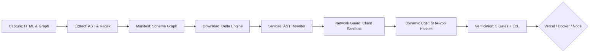

# Architecture & Technical Design: `realfood-mirror`

A strict, zero-egress offline mirror and parity verification pipeline for modern
Next.js sites, built for [`realfood.gov`](https://realfood.gov).

---

## 1. System overview

`realfood-mirror` captures, sanitizes, and hosts a full offline replica of
`realfood.gov` without leaking user traffic or metadata to third-party telemetry
providers. It ships three deployment targets from one canonical security policy.

---

## 2. Core architectural pillars

### A. Client-side anti-tamper network guard

The browser runtime is sealed against unauthorized telemetry egress by injecting
`/stubs/network-guard.js` at the top of `<head>`:

- **Egress interception**: monkey-patches `window.fetch`, `XMLHttpRequest`,
  `navigator.sendBeacon`, `EventSource`, `WebSocket`, `Worker`, and
  `ServiceWorker` registration.
- **DOM mutation trapping**: intercepts `Node.appendChild`, `Node.insertBefore`,
  and `Element.setAttribute` to block late-injected tracker elements.
- **In-memory audit buffer**: records every trapped attempt in
  `window.__MIRROR_BLOCKED_REQUESTS__` and emits `mirror-network-blocked`.
- **Deny list**: Cloudflare challenge/insights, PostHog ingest/assets, and
  Cloudflare Stream (`embed.videodelivery.net`), generated from
  `mirror.config.mjs`. It is defense in depth; the sanitizer and CSP are the
  primary controls.

### B. Canonical cryptographic policy

`security/policy.mjs` is the single source of truth for CSP and static headers.

1. `scripts/mirror/update-production-csp.mjs` computes SHA-256 digests for every
   inline script in `public/index.html`.
2. It writes the same CSP (hashes included) to `vercel.json` and
   `nginx/security-headers.conf`.
3. The Node server builds a per-response nonce from the same directive list.
4. `script-src` may not contain `unsafe-inline` or `unsafe-eval`; the generator
   exits non-zero if either appears.
5. `style-src 'unsafe-inline'` is the only accepted relaxation, required by
   element-level styles in the captured React build.

### C. CORS

`security/cors.mjs` is shared by Edge middleware and serverless functions. It
reflects only exact configured origins plus the deployment's own `VERCEL_URL` /
`VERCEL_PROJECT_PRODUCTION_URL`, rejects `null`, never enables credentials, and
allows localhost only outside production. Disallowed origins receive
`Vary: Origin` and no grant.

### D. Multi-tiered parity verification

1. **Byte parity** (`verify-byte-parity.mjs`): SHA-256 comparison between local
   files and live remote assets.
2. **DOM AST parity** (`verify-dom-parity.mjs`): normalizes whitespace, nonces,
   and stub scripts before comparing structural DOM hashes.
3. **Network egress gate** (`verify-network-gate.mjs`): headless browser
   assertion of zero non-allowlisted HTTP requests.
4. **Visual regression** (`compare-parity.mjs`): Pixelmatch comparison across
   desktop (1440×900) and mobile (390×844), with calibrated thresholds for
   dynamic media.
5. **Policy and integrity gates** (`scripts/ci/*`): CSP/header/CORS contract,
   blocked-host/external-subresource/secret/source-map scan, dependency audit.

---

## 3. Pipeline stages

| Stage | Script | Purpose |
|---|---|---|
| 1. Capture HTML | `scripts/mirror/capture-html.mjs` | Fetch raw upstream entrypoint HTML |
| 2. Runtime graph | `scripts/mirror/capture-runtime-graph.mjs` | Record dynamic Next.js network graph |
| 3. Static refs | `scripts/mirror/extract-static-refs.mjs` | Extract assets from HTML and CSS |
| 4. Manifest | `scripts/mirror/build-manifest.mjs` | Unify asset lists into schema-validated JSON |
| 5. Download | `scripts/mirror/download-assets.mjs` | Concurrent downloader with delta caching |
| 6. Sanitize | `scripts/mirror/sanitize-third-party.mjs` | Strip tracker/CDN hosts from JS and CSS |
| 7. Sanity | `scripts/mirror/verify-sanity.mjs` | Payload size and asset-count invariants |
| 8. Rewrite | `scripts/mirror/rewrite-html.mjs` | AST rewrite + network guard injection |
| 9. Dynamic CSP | `scripts/mirror/update-production-csp.mjs` | Hash inline scripts for every target |

---

## 4. Deployment targets

### Vercel (production source of truth)

- Static payload from `public/`, headers from `vercel.json`.
- Edge middleware (`middleware.js`) terminates stub requests with exact-origin
  CORS and method allowlists.
- Serverless functions: `api/stub.js` (telemetry no-op), `api/csp-report.js`
  (POST-only, 64 KB cap, content-type validation, no logging/persistence).
- Rewrites route `/e`, `/e/*`, `/decide`, `/decide/*`, and query-variant stub
  paths to the function; no cron endpoint exists.

### Netlify (portable production deployment)

- `netlify.toml` publishes `public/` and bundles `netlify/functions/`.
- `public/_headers` is generated from `vercel.json` by
  `npm run netlify:headers`; `npm run policy:check` fails on drift.
- `public/_redirects` maps `/e`, `/decide`, `/api/stub`, and `/api/csp-report`
  to the functions and fails unknown `/api/*` paths closed with `404`.
- `netlify/functions/stub.mjs` reuses `security/cors.mjs`, allows same-origin
  telemetry, rejects `null` and arbitrary `*.vercel.app` origins, and exposes
  only `GET`, `HEAD`, `POST`, and `OPTIONS`.
- `/cdn-cgi/image/:options/images/*` rewrites to the mirrored image path, so
  the captured responsive image URLs resolve without a third-party optimizer.
- The project-level **Powered by Netlify badge must stay disabled**. Netlify
  injects that script into static HTML before hydration, which mutates the DOM
  and forces a full client re-render. `npm run smoke:deploy` fails if the
  `data-nf-variant` marker or `/.netlify/scripts/hud` reappears.

### Docker / Nginx (air-gapped)

- `nginxinc/nginx-unprivileged:1.27-alpine`, `USER 101`, port 8080.
- `server_tokens off`; exact telemetry regex; POST-only CSP sink.
- Security headers are included in every location that sets its own header.
- Dotfiles and `.map` files denied; static methods restricted to GET/HEAD.
- Compose runs read-only with `cap_drop: ALL`, `no-new-privileges`, and
  `noexec,nosuid` tmpfs for `/tmp` and `/var/cache/nginx`.
- `/healthz` backs the container healthcheck.

### Local Node server

- Dependency-free HTTP server for parity and security checks.
- GET/HEAD only; telemetry stub surface; per-response CSP nonce.
- Canonical-path containment; directory requests return 404; stream errors are
  contained; malformed requests cannot crash the process.
- IP rate limiting (localhost exempted for tests).

---

## 5. Supply-chain model

- CI runs with `permissions: contents: read` on Node 24.
- The daily sync has only `contents: write` + `pull-requests: write`; it opens a
  branch/PR and cannot push `main`.
- Dependabot tracks npm, GitHub Actions, and Docker weekly.
- `npm audit --audit-level=high` is a merge gate.
- `scan-mirror-integrity.mjs` blocks tracker hosts, external subresources,
  secrets, source maps, and the return of the removed 37 MB orphan tree.
- `.env*`, `artifacts/`, reports, and test output are gitignored and checked.

---

## 6. Testing topology

| Layer | Location | What it proves |
|---|---|---|
| Unit | `tests/unit` | Policy, schema, CORS, sanitizer, DOM normalization |
| Server security | `tests/security` | Crash, methods, ranges, traversal, nonce, headers |
| Exploit probes | `scripts/security/exploit-probes.mjs` | Re-runs audit findings against a live hardened server |
| E2E | `tests/e2e` | Sections render, no blocked requests, PDFs local, headers, routes |
| Parity | `scripts/mirror/verify-*` | Byte/DOM/network/visual equivalence |
| Policy | `scripts/ci/check-security-policy.mjs` | Deployed config equals canonical policy |
| Integrity | `scripts/ci/scan-mirror-integrity.mjs` | No egress, secrets, maps, or orphan payload |

The full threat model and finding-level evidence live in
[`docs/security-audit-2026-11-11.md`](docs/security-audit-2026-11-11.md).
