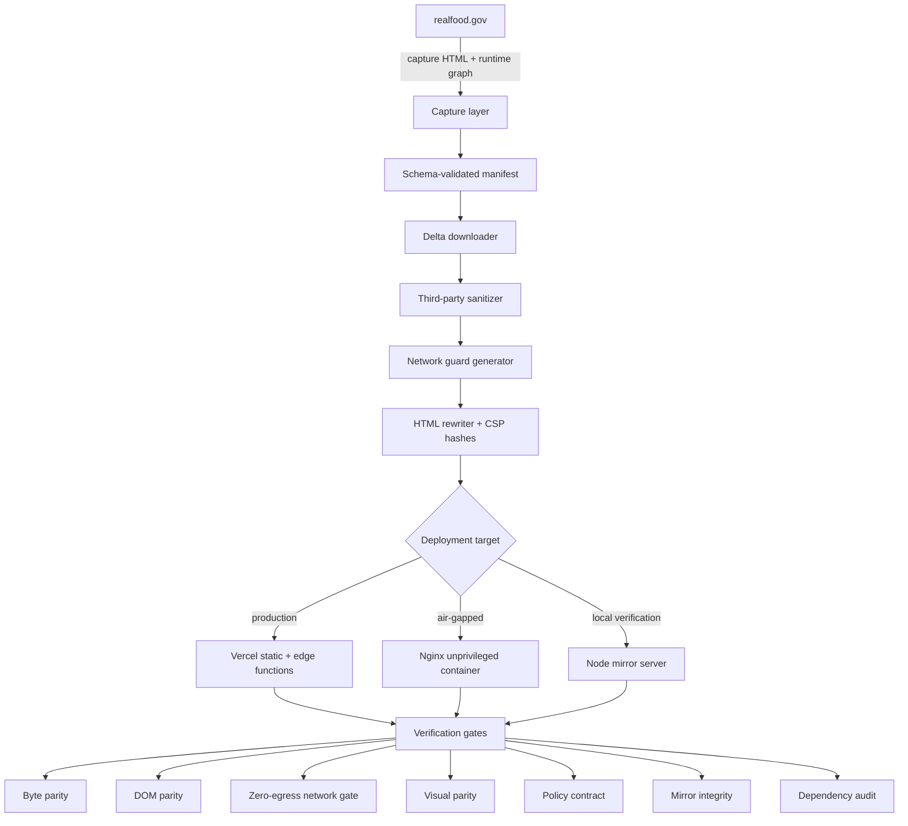

# realfood-mirror

**A zero-egress, review-gated, cryptographically policed mirror of [realfood.gov](https://realfood.gov).**

[](https://github.com/MdSaifulIslamMSI/realFood/actions/workflows/ci.yml)
[](SECURITY.md)
[](docs/security-audit-2026-11-11.md)
[](package.json)
[](LICENSE)

---

## What this is

`realfood-mirror` captures the public `realfood.gov` site, strips every tracker
and third-party dependency, rewrites the payload for offline/air-gapped
delivery, and serves it through three independently hardened targets:

1. **Vercel** — production static hosting, edge middleware, serverless stubs.
2. **Docker + Nginx** — unprivileged, read-only, capability-free container.
3. **Node.js** — dependency-free local verification server.

The repository is not a screenshot archive. It is a reproducible supply-chain
pipeline with byte, DOM, network, visual, policy, and integrity gates. A failed
gate blocks the change.

### Security invariants

- **Vercel deployment path is the production security source of truth.**
- **No `unsafe-eval` is allowed in deployed CSP.**
- **Telemetry routes `/e` and `/decide` are actively routed to the local stub interceptor.**
- No wildcard CORS, no reflected `*.vercel.app` origins, no `Access-Control-Allow-Origin: null`.
- Upstream sync can open a pull request but **cannot push to `main`**.
- The Docker image runs as UID 101 with a read-only root filesystem and zero Linux capabilities.

---

## Architecture



### Data flow security boundaries

| Boundary | Trust | Enforcement |
|---|---|---|
| Upstream HTML/assets | Untrusted | Sanitizer, blocked-host manifest, network guard, review-gated sync |
| Build scripts | Trusted | Deterministic hashing, schema validation, CI gates |
| Pull requests | Untrusted | Read-only `GITHUB_TOKEN`; no secrets; review required |
| Browser runtime | Partially trusted | Nonce/hash CSP, no external egress, DOM mutation traps |
| Container runtime | Least privilege | UID 101, `read_only`, `cap_drop: ALL`, `no-new-privileges` |

---

## Quick start

**Requirements:** Node.js 22+ (CI uses Node 24), npm 10+, optional Docker 27+.

```bash
git clone https://github.com/MdSaifulIslamMSI/realFood.git
cd realFood
npm ci
npm run test:unit
npm run serve
# open http://127.0.0.1:4173
```

Air-gapped container:

```bash
docker build -t realfood-mirror .
docker compose up -d
curl -I http://127.0.0.1:8080/
```

The container listens on **8080**, runs as **UID 101**, and is read-only except
for two small `tmpfs` mounts required by Nginx.

---

## Command surface

| Command | Purpose |
|---|---|
| `npm run serve` | Start the hardened Node mirror on `127.0.0.1:4173` |
| `npm run mirror:refresh` | Capture upstream and rebuild the mirror snapshot |
| `npm run mirror:orchestrate` | Full orchestrated sync used by the scheduled workflow |
| `npm run mirror:verify` | Byte, DOM, network, and sanity verification |
| `npm run test:unit` | Unit + server security regression suite (Vitest) |
| `npm run security:probe` | Re-run the audit's exploit probes against a hardened server |
| `npm run test:e2e` | Playwright E2E, local or `PREVIEW_URL` |
| `npm run test:parity` | Capture and compare visual parity screenshots |
| `npm run policy:check` | Enforce canonical CSP/header/CORS contract |
| `npm run check:mirror-integrity` | Block trackers, external subresources, secrets, source maps |
| `npm run check:tracked-generated` | Reject committed build artifacts |
| `npm run audit:deps` | `npm audit --audit-level=high` |
| `npm run ci:local` | Full local gate: typecheck, tests, exploit probes, policy, integrity, audit |
| `npm run ci:audit-report` | Run every gate and emit `artifacts/ci/audit-report.json` |

---

## Security architecture

### 1. Content Security Policy

The single source of truth is [`security/policy.mjs`](security/policy.mjs).
`scripts/mirror/update-production-csp.mjs` computes SHA-256 hashes for every
inline script and writes the exact same policy to:

- `vercel.json` (production),
- `nginx/security-headers.conf` (Docker),
- the Node server at runtime (per-response nonce).

```text
default-src 'self'; script-src 'self' 'sha256-…' …; style-src 'self' 'unsafe-inline';
img-src 'self' data: blob:; media-src 'self' data: blob:; font-src 'self' data:;
connect-src 'self'; worker-src 'self' blob:; object-src 'none';
frame-ancestors 'none'; base-uri 'self'; form-action 'self'; report-uri /api/csp-report
```

- `script-src` never contains `unsafe-inline` or `unsafe-eval`.
- Every inline script in `public/index.html` is hashed; a new inline script
  without a hash fails CI.
- `style-src 'unsafe-inline'` is the only accepted relaxation, required by
  Next.js element-level style attributes. It cannot execute code.
- Violations are posted to `/api/csp-report`, which validates content type,
  caps the body at 64 KB, and deliberately does not log or persist reports.

### 2. CORS and telemetry stubs

[`security/cors.mjs`](security/cors.mjs) is shared by the Edge middleware and
the serverless handlers.

- Only exact `ALLOWED_ORIGINS`, `ALLOWED_ORIGIN`, `VERCEL_URL`, and
  `VERCEL_PROJECT_PRODUCTION_URL` values are reflected.
- `https://anything.vercel.app` is **not** trusted.
- `null` is never granted.
- Credentials are never enabled.
- `localhost` is accepted only outside `VERCEL_ENV=production`.

The PostHog/Cloudflare compatibility endpoints `/e`, `/e/*`, `/decide`, and
`/decide/*` terminate in a local 200/204 stub. Request bodies are ignored and
never forwarded.

### 3. Zero-egress runtime guard

[`public/stubs/network-guard.js`](public/stubs/network-guard.js) is generated
from [`mirror.config.mjs`](mirror.config.mjs). It patches:

- `fetch`, `XMLHttpRequest`, `navigator.sendBeacon`,
- `WebSocket`, `EventSource`, `Worker`, `ServiceWorker`,
- `Node.appendChild`, `Node.insertBefore`, `Element.setAttribute`.

Blocked hosts: Cloudflare challenge/insights, PostHog ingest/assets, and
Cloudflare Stream (`embed.videodelivery.net`). Every blocked attempt is recorded
in `window.__MIRROR_BLOCKED_REQUESTS__` and surfaced as a
`mirror-network-blocked` event.

### 4. Nginx and container hardening

- `server_tokens off`; exact telemetry routing; POST-only CSP sink.
- Security headers are re-included in **every** location that declares its own
  `add_header`, fixing Nginx's inheritance footgun that previously stripped
  CSP/HSTS from all asset responses.
- Dotfiles and `.map` files are denied.
- State-changing methods return 405 on static content.
- Base image: `nginxinc/nginx-unprivileged:1.27-alpine`, `USER 101`.
- Compose: read-only root, dropped capabilities, `no-new-privileges`,
  `noexec,nosuid` tmpfs.

### 5. Supply chain

- `npm audit --audit-level=high` must report zero high/critical advisories.
- Dependabot tracks npm, GitHub Actions, and Docker bases weekly.
- CI has `permissions: contents: read`.
- The daily upstream sync has only `contents: write` and
  `pull-requests: write`; it opens a review PR and can never push `main`.
- `scan-mirror-integrity.mjs` fails on blocked hosts, external subresources,
  private keys/tokens, source maps, or the return of the orphaned 37 MB subtree.
- The previous `public/assets/mirror/realfood.gov` tree (including a 231 KB HTML
  file served as `browserconfig.xml`) was removed after proving it had no
  references.

---

## Threat model and audit

The full before/after report is [`docs/security-audit-2026-11-11.md`](docs/security-audit-2026-11-11.md).
Headline findings that were reproduced and fixed:

| Finding | Before | After |
|---|---|---|
| Directory request crash | `GET /images/` raised unhandled `EISDIR`, killing the server | `404`, process stays alive |
| Method confusion | `POST/PUT/DELETE/OPTIONS/TRACE /` returned `200` HTML | `405` with `Allow` |
| Range parsing | Suffix range returned wrong slice; multi-range mis-served | RFC 7233 suffix/open-ended parsing; multi-range `416` |
| CORS reflection | Any `https://*.vercel.app` reflected; `null` granted | Exact allowlist; disallowed origins get `Vary` only |
| Header inheritance | Asset locations dropped CSP/HSTS | Every location includes the generated snippet |
| CSP drift | Nginx CSP lacked inline-script hashes | Generated from the same policy as Vercel |
| Telemetry gap | `embed.videodelivery.net` unblocked | Blocked in guard, config, and sanitizer |
| Orphan payload | 37.34 MB unreferenced tree + malformed XML | Removed; integrity gate prevents return |
| Supply chain | Daily sync pushed directly to `main` | Review branch + PR only |

### Residual risk (explicit)

- `style-src 'unsafe-inline'` — required by the captured React build; no code execution.
- The Docker image is HTTP-only; deploy behind a TLS terminator for HSTS to matter.
- Upstream content itself is still third-party input. Byte/DOM/visual/network
  parity and human review reduce, but cannot eliminate, that risk.
- GitHub Actions use major-version tags. Dependabot updates them; SHA pinning is
  recommended for high-assurance forks.

---

## Verification

Run the same gates CI runs:

```bash
npm ci
npm run ci:local
npm run test:e2e
npm audit --audit-level=high
```

Container verification:

```bash
docker build -t realfood-mirror .
docker run --rm -d --name realfood-check -p 18080:8080 realfood-mirror
curl -sI http://127.0.0.1:18080/ | grep -Ei 'content-security|x-frame|referrer|permissions|cross-origin|strict-transport'
curl -sI http://127.0.0.1:18080/_next/static/chunks/386-329e5ca5ca162a74.js | grep -Ei 'content-security|x-frame'
curl -s -o /dev/null -w '%{http_code}\n' -X POST http://127.0.0.1:18080/
docker rm -f realfood-check
```

Expected: security headers on both HTML and asset responses, and `405` for the
POST probe.

### What CI enforces

| Gate | Failure condition |
|---|---|
| `typecheck` | TypeScript errors |
| `test:unit` | Any unit or server-security regression |
| `policy:check` | CSP/header/CORS drift, missing README claim, missing inline hash |
| `check:mirror-integrity` | Tracker host, external subresource, secret, source map, orphan tree |
| `check:tracked-generated` | `artifacts/`, reports, or test output committed |
| `audit:deps` | High/critical dependency advisory |
| `test:e2e` | Section loss, blocked request, header regression, broken PDF, route regression |
| `test:parity` | Visual drift beyond calibrated thresholds |

---

## Repository layout

```text
api/                     Vercel functions: telemetry stub, CSP report sink
security/                Canonical CSP/header/CORS policy (single source of truth)
scripts/mirror/          Capture, download, sanitize, rewrite, serve, verify
scripts/ci/              Policy, integrity, tracked-artifact, and audit gates
public/                  Mirrored payload + generated guards/stubs
nginx/                   Generated security-header snippet
tests/unit/              Policy, schema, CORS, sanitizer tests
tests/security/          Exploit-regression suite for the Node server
tests/e2e/               Playwright route, header, egress, PDF tests
docs/                    Audit report and deep design notes
nginx.conf               Hardened container server config
Dockerfile               Unprivileged Nginx image
docker-compose.yml       Read-only, capability-free runtime
vercel.json              Production headers, rewrites, build config
```

---

## Operations runbook

**A scheduled sync opened a PR.** Review the asset diff, confirm the integrity
and parity jobs are green, then merge. The sync job cannot merge or push `main`.

**CSP violations appear in the browser console.** Check `/api/csp-report`
ingestion, then run `npm run policy:check`. Add a hash only via
`node scripts/mirror/update-production-csp.mjs`; never add `unsafe-inline`.

**A dependency advisory lands.** Dependabot opens a PR. Run `npm ci`,
`npm run ci:local`, and `npm run test:e2e` before merging. Do not suppress
advisories in `.npmrc`.

**The container fails its healthcheck.** Inspect
`docker logs realfood-mirror`; verify `/healthz` and that the read-only mounts
exist. Do not run the container as root to "fix" it.

---

## Contributing

1. Fork and create a topical branch.
2. Run `npm ci && npm run ci:local && npm run test:e2e`.
3. Keep security policy changes centralized in `security/policy.mjs`; regenerate
   deployment targets with the provided scripts.
4. Never commit `.env*`, `artifacts/`, reports, or captured credentials.
5. Open a PR. Security-sensitive changes require review.

See [`SECURITY.md`](SECURITY.md) for disclosure and [`ARCHITECTURE.md`](ARCHITECTURE.md)
for the full design.

---

## License and content notice

Source code is licensed under the [MIT License](LICENSE). The mirrored content,
names, and marks belong to their respective owners; see [NOTICE](NOTICE). This
project is an independent archival mirror and is not affiliated with or endorsed
by the U.S. Department of Agriculture, the U.S. Department of Health and Human
Services, or realfood.gov.
